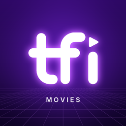

# TFI Movies

A free Stremio addon with movies and web series **in Telugu**, new on Indian OTT: the latest Telugu releases, plus Tamil, Malayalam, Kannada, English and Hindi titles dubbed in Telugu. Eight catalogs, refreshed automatically every day, also published as public TMDB lists.

**Install:** open [tfi-movies.vercel.app](https://tfi-movies.vercel.app), pick the catalogs you want (and their order) and press *Install in Stremio*, or paste `https://tfi-movies.vercel.app/manifest.json` (all catalogs) into the search box on Stremio's Addons page.

TFI Movies only adds catalogs (posters, details, ratings and trailers). It doesn't host or link to any video.

## Telugu audio only

Every title most probably has Telugu audio, which is the point of the addon. It isn't guaranteed: TFI Movies only lists titles and doesn't provide streams, so whether you actually get Telugu audio depends on your stream addons and how they're configured. Telugu films and series are in automatically. Each dubbed title is checked daily:

- **Confirmed:** [JustWatch](https://www.justwatch.com/in) lists Telugu audio for one of its Indian streaming offers, Netflix's title page lists Telugu, it's on ETV Win (Telugu only), or OTT release news says so (Sacnilk's audio languages, 123telugu's "Telugu Dub").
- **Left out:** the services list the audio languages and Telugu isn't one of them. That beats a news report of Telugu audio. A provider's list that leaves out the title's own language counts as incomplete, so it can confirm Telugu but not rule it out. Titles JustWatch doesn't know at all (mostly obscure films and stand-up specials) are left out too, unless the news confirms Telugu.
- **Kept, unconfirmed:** JustWatch knows the title but no service lists its audio languages (mostly Sun NXT), so it gets the benefit of the doubt.

A home server does the lookups (hundreds of pages on the first run, too slow for one Vercel function) from [`/candidates.json`](https://tfi-movies.vercel.app/candidates.json) and publishes the results as `audio.json` in [anonvibes/tfi-data](https://github.com/anonvibes/tfi-data). Titles without confirmed Telugu are looked up again every week, since dubs are often added later. A title the check hasn't seen yet waits for its next run.

## Movie lists

| List | What it shows |
|---|---|
| Telugu Movies | Telugu films streaming in India, latest OTT arrivals first |
| Telugu Dubbed: South | Tamil, Malayalam and Kannada films with Telugu audio |
| Telugu Dubbed: English | English films with Telugu audio |
| Telugu Dubbed: Hindi | Hindi films with Telugu audio |

Each list holds up to 100 films that are on Netflix, Prime Video, JioHotstar, Aha, ZEE5, SonyLIV, Sun NXT or ETV Win in India. Films that TMDB gives an Indian digital (OTT) release date in the last 120 days are included too, so new OTT arrivals show up before TMDB's "Where to Watch" catches up. Lists are ordered by when each film arrived on OTT in India (its Indian digital release date on TMDB), or by its main release date when TMDB doesn't have one. The dubbed lists look back up to a year (`POOL_DAYS`) to find 100 films with Telugu audio.

- **News check:** each daily refresh also reads the OTT release listings on [Sacnilk](https://www.sacnilk.com/ott-movie-releases) and [123telugu](https://www.123telugu.com/videos/ott), plus [91mobiles](https://www.91mobiles.com/entertainment/ott-release-this-week) (it blocks servers, so a home server reads it daily at 5:00 IST into the public repo [anonvibes/tfi-data](https://github.com/anonvibes/tfi-data); its OTT dates win), matches each film to TMDB, and adds it to the right list using the OTT date from the news. This catches films TMDB hasn't marked as streaming yet. Only clear, single matches are added.
- **Review page:** [tfi-movies.vercel.app/review](https://tfi-movies.vercel.app/review) lists popular films that were in Indian cinemas 4–10 weeks ago but aren't in any list (possibly missing), plus news reports that couldn't be matched to one TMDB film. It never changes the lists.
- **Daily refresh:** Vercel runs `/sync` once a day, around 6–7 am IST. Opening `/sync?key=<CRON_SECRET>` runs it straight away and shows each list's link.

## Series lists

| List | What it shows |
|---|---|
| Telugu Series | Telugu web series streaming in India |
| Telugu Dubbed Series: South | Tamil, Malayalam and Kannada web series with Telugu audio |
| Telugu Dubbed Series: English | English web series with Telugu audio |
| Telugu Dubbed Series: Hindi | Hindi web series with Telugu audio |

Each holds up to 100 series on the same platforms. A series is ranked by when its newest season started, so a new season of an older show comes up next to brand-new shows. Web series only: TV serials and daily soaps (any season longer than 40 episodes), reality shows, talk shows and news are left out, plus well-known reality franchises by name (Bigg Boss, Indian Idol, …), since TMDB lists some of them as scripted. Vercel runs `/sync-series` once a day, around 7–8 am IST; opening `/sync-series?key=<CRON_SECRET>` runs it straight away. The news check covers series too: series that 123telugu and 91mobiles report as new on OTT are matched to TMDB and added, which catches aha / ETV Win originals TMDB doesn't show as streaming. When the news reports a season TMDB doesn't have yet, the news date is used. Talk and reality shows ("Hindi show") and weekly episode drops in the news are ignored. Unmatched series are listed under `news` in the `/sync-series` result.

## Stremio addon

The addon shows the same eight catalogs (movies under Movies, series under Series): the first 100 titles in each come straight from the TMDB lists, and scrolling further loads older ones. Pick catalogs and their order on the home page (or start from a preset: Telugu originals, dubbed only, movies only, series only), or name them in the link, in the order Stremio should show them: `https://tfi-movies.vercel.app/te,south,te-tv/manifest.json` (keys `te`, `south`, `en`, `hi` for movies and `te-tv`, `south-tv`, `en-tv`, `hi-tv` for series). Stremio's *Configure* button opens the picker again. Movies and series use IMDb IDs where they have one, so other Stremio addons (subtitles, for example) work with them as usual.

## Run your own copy

1. Fork this repo and import it into [Vercel](https://vercel.com) (free Hobby plan is enough).
2. Add `TMDB_API_KEY` (and `CRON_SECRET`, any long random text) under **Settings → Environment Variables**, then redeploy.
3. **One-time connection:** the sync edits lists through your TMDB account. Open `/tmdb-connect` on your deployment, approve on TMDB, and save the key it shows as `TMDB_USER_TOKEN` in Vercel. Once that's set, `/tmdb-connect` only works as `/tmdb-connect?key=<CRON_SECRET>`.
4. Open `/sync?key=<CRON_SECRET>` and `/sync-series?key=<CRON_SECRET>` once to create the lists. After that, Vercel's cron keeps them fresh.

**Lists are found by name.** Renaming a list on TMDB makes the next sync create a fresh one; deleting one does the same.

## Settings

Set these in Vercel under **Settings → Environment Variables**, then redeploy.

| Variable | Default | What it does |
|---|---|---|
| `TMDB_API_KEY` | — | Required. TMDB API key or Read Access Token |
| `TMDB_READ_TOKEN` | — | TMDB "API Read Access Token". Only needed for `/tmdb-connect` if `TMDB_API_KEY` is the short key |
| `TMDB_USER_TOKEN` | — | Lets the sync edit your lists. Created by `/tmdb-connect` |
| `LIST_SIZE` | `100` | Movies per list (max 500) |
| `DIGITAL_DAYS` | `120` | Also include films with an Indian digital release date in this many past days; `0` turns it off |
| `NEWS_CHECK` | `on` | `off` stops reading OTT release news |
| `CRON_SECRET` | — | Recommended. When set, `/sync` and `/sync-series` only run for Vercel's scheduler or with `?key=<secret>` |
| `META_LANGUAGE` | `en-US` | `te-IN` shows Telugu-script titles where TMDB has them |
| `AUDIO_URL` | tfi-data's `audio.json` | Results of the daily Telugu audio check |
| `POOL_DAYS` | `365` | How far back the dubbed lists look for titles with Telugu audio |
| `DUB_SOURCE_LANGS` | `ta\|ml\|kn` | Languages in "Telugu Dubbed: South" |
| `DUB_MIN_VOTES` | `3` | Hides obscure titles from "Telugu Dubbed: South" |
| `EN_DUB_MIN_VOTES` | `20` | Minimum TMDB votes for "Telugu Dubbed: English" |
| `HINDI_MIN_VOTES` | `0` | Set e.g. `5` to hide obscure titles from "Telugu Dubbed: Hindi" |
| `MIN_RUNTIME` | `60` | Hides shorts (minutes); `0` turns it off |
| `DUB_SERIES_MIN_VOTES` | `0` | Minimum TMDB votes for "Telugu Dubbed Series: South" |
| `EN_SERIES_MIN_VOTES` | `20` | Minimum TMDB votes for "Telugu Dubbed Series: English" |
| `HINDI_SERIES_MIN_VOTES` | `0` | Minimum TMDB votes for "Telugu Dubbed Series: Hindi" |
| `SERIES_MAX_EPISODES` | `40` | A series with a longer season counts as a TV serial and is left out; `0` turns it off |
| `SERIES_SKIP_TITLES` | `bigg boss\|indian idol\|…` | Series whose names match are left out (reality and talk shows TMDB lists as scripted) |
| `CACHE_HOURS` | `6` | How often the addon's catalogs refresh |
| `WATCH_REGION` | `IN` | Streaming region |

## Good to know

- TMDB doesn't record audio languages, which is why the dubbed lists rely on the Telugu audio check above. Titles no service lists audio for are kept, so a few of those may turn out not to have Telugu.
- Films with no Indian digital release date on TMDB are placed by their main release date, so they can sit lower than they should. Films released more than a year ago always use their main release date, so old films newly added to a platform don't jump to the top.
- ETV Win-only films never appear, because TMDB's streaming data (from JustWatch) doesn't cover ETV Win.

## Files

| Path | Purpose |
|---|---|
| `api/index.js` | Movie and series list sync, review page, install page and Stremio addon |
| `lib/news.js` | Reads and matches OTT release news (including when it reports Telugu audio); the possibly-missing check |
| `lib/logo.js` | Addon logo (served at `/logo.png`) |
| `vercel.json` | Sends every request to `api/index.js`, and schedules the daily `/sync` and `/sync-series` |

## AI disclaimer

TFI Movies was built with the help of AI: the code, the home page and the catalog rules. The catalogs are made automatically every day, without a person checking each title, so a title, date or audio language can be wrong. Spot a mistake? [Open an issue](https://github.com/anonvibes/TFI/issues).

---

This product uses the TMDB API but is not endorsed or certified by TMDB.
